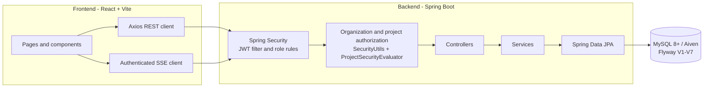

# TaskFlow — Enterprise Project & Workflow Management

TaskFlow is a full-stack, multi-tenant project and workflow management application for engineering organizations. It combines role-governed administration, delivery workflows, QA test management, downloadable analytics, and a live analytics dashboard in one React + Spring Boot workspace.

## Repository

- **GitHub:** https://github.com/fromchaithra/TaskFlow
- **Clone:** `git clone https://github.com/fromchaithra/TaskFlow.git`
- **Default branch:** `master`

### Repository layout

| Path | Contents |
|---|---|
| `taskflow-backend/` | Spring Boot REST API, security, analytics, reporting, and Flyway migrations |
| `taskflow-frontend/` | React + Vite single-page application |

The repository root also contains leftover scaffold files from the original AI Studio template (`index.html`, `package.json`, `src/`, `tsconfig.json`, `vite.config.ts`, `metadata.json`, `projectmanager.sql`). They are **not** used by the TaskFlow application, are not part of the build, and are intentionally left untouched.

---

## Overview and problem statement

Engineering teams often track work across disconnected tools: one system for projects and tasks, another for bugs and QA, spreadsheets for reporting, and ad-hoc dashboards for live status. That fragmentation makes it hard to answer basic delivery questions with confidence, and it becomes worse when multiple organizations or customers share a platform.

TaskFlow addresses this by providing one workspace where:

- Data is **organization-scoped** and authorization is enforced on the server.
- Managers can run projects, sprints, and task workflows with clear status transitions.
- QA teams can manage test cases, suites, runs, and executions alongside defects.
- Stakeholders can generate **real PDF and Excel reports** from authorized data.
- Live delivery metrics stream to the UI over authenticated SSE, with a REST fallback.

The application is designed as a portfolio-grade example of secure Java full-stack development: Spring Boot 4, React 19, JWT/HttpOnly-cookie authentication, Flyway-managed MySQL schema, and role-based multi-tenancy.

---

## Screenshots

> Screenshot placeholders — real captures will be added after final demo cleanup. No generated or simulated screenshots are included.

| Area | Status |
|---|---|
| Login and public registration | Placeholder — screenshot to be added |
| Admin dashboard with role-based KPI cards | Placeholder — screenshot to be added |
| Employee dashboard (assigned-project scope) | Placeholder — screenshot to be added |
| Projects list and project detail | Placeholder — screenshot to be added |
| Kanban board with task status columns | Placeholder — screenshot to be added |
| Bug detail and attachments | Placeholder — screenshot to be added |
| Reports catalog and PDF/XLSX generation | Placeholder — screenshot to be added |
| Live Analytics with charts and "Live" indicator | Placeholder — screenshot to be added |
| Dark theme | Placeholder — screenshot to be added |

---

## Key features

### Authentication and Multi-tenancy

- JWT access tokens signed with HS256; short-lived tokens are kept **in memory only** (`tokenManager`).
- Session persistence uses an HttpOnly `tf_refresh` cookie with single-flight refresh calls.
- Refresh-token rotation with reuse detection: replaying a revoked refresh token revokes the token family.
- Logout revokes the access-token JTI and the presented refresh token.
- **Each public signup creates an independent organization with its own Admin.**
- **Multiple Admins per organization are supported** by existing authorized management flows.
- Roles: `ADMIN`, `PROJECT_MANAGER`, `DEVELOPER`, `QA_TESTER`; organization/project scope is resolved from the authenticated user on the server.
- Account activation flow using backend-issued activation tokens.
- Rate limiting on public authentication and registration endpoints with HTTP 429 responses.

### Organization and Team Management

- Organization profile, timezone, working days, and metadata.
- Team creation, editing, deactivation, lead assignment, and membership management.
- Member counts and role badges; Admin-only organization and team administration.

### Project and Task Management

- Project creation, editing, status transitions, archival, and membership management.
- Project managers can manage assigned projects; employees see only authorized projects.
- Task CRUD, assignment, due dates, board order, and status transitions.
- Kanban board with drag-and-drop powered by `@dnd-kit`.
- Task comments and activity history; filters, pagination, and sorting.

### Sprint and Bug Tracking

- Sprint planning with start/complete/cancel lifecycle, overlap protection, and serialized activation.
- Sprint reports including velocity and burndown data derived from real history.
- Bug reporting with severity and status workflows, assignment, verification/reopening, comments, and history.
- Bug attachments with authenticated upload, download, and permission-aware deletion.

### QA Test Management

- Test cases, suites, runs, and executions.
- Test step validation, execution results, and defect linking from failed executions.
- QA/project membership restrictions; developers are excluded from QA mutation endpoints by role policy.

### Analytics and Reporting

- **Ten analytics report types**: Executive Overview, Project Performance, Project Growth, Sprint Velocity, Sprint Burndown, Task Completion Trends, Team Productivity, Employee Workload, Bug Trends, and QA Analytics.
- PDF and XLSX exports generated server-side with Apache PDFBox and Apache POI.
- Date range, granularity, project, team, employee, and comparison filters.
- Empty/unavailable data is explained rather than shown as fabricated zeros.
- Report scope is re-resolved from authorization on every request.

### Notifications and Live Analytics

- Notifications and a recent-activity feed backed by audit logging.
- Live Analytics over authenticated SSE (`/api/v1/live/analytics`) with a REST snapshot fallback.
- Role-specific dashboard KPIs and charts.
- Live subscriptions are scoped to the viewer's organization and authorized projects, revalidated periodically, and closed on logout.

---

## Technology stack

| Layer | Technologies |
|---|---|
| Frontend | React 19, Vite 6, React Router 7, Axios, Tailwind CSS 4, Recharts, framer-motion, lucide-react, @dnd-kit |
| Backend | Java 21, Spring Boot 4.1.2 (WebMVC, Security, Data JPA, Validation, Flyway, Actuator), JJWT, Apache PDFBox, Apache POI, springdoc-openapi |
| Database | MySQL 8+ / Aiven MySQL for runtime; H2 in-memory for automated tests |
| Build & tooling | Maven 3.9+, Node.js 20+, npm, Vite, Flyway migrations V1–V7 |
| Testing | JUnit 5 / Spring Boot Test (backend); production build verification via Vite (frontend) |

---

## Application architecture



The browser only supplies an access token and filter parameters. The backend derives the viewer's organization and project visibility from the authenticated user, so client-supplied organization IDs or permission lists cannot widen access. Reports and live streams re-apply this authorization when they are requested.

---

## Getting started

### Prerequisites

- JDK 21
- Maven 3.9+ (no Maven wrapper is committed)
- Node.js 20+ and npm
- A MySQL 8+ database (local or Aiven) for the demo runtime; automated tests use H2

### Backend — local development

1. Copy `taskflow-backend/.env.example` to `taskflow-backend/.env` and fill in values for your environment. The `.env` file is git-ignored; **never commit real credentials**.
2. Required environment variable **names** (no values shown here):
   - Runtime: `SPRING_PROFILES_ACTIVE`, `SERVER_PORT`
   - Database: `DB_HOST`, `DB_PORT`, `DB_NAME`, `DB_USERNAME`, `DB_PASSWORD`, `DB_SSL_MODE`
   - Security: `JWT_SECRET` (minimum 256 bits / 32 bytes), `JWT_ACCESS_EXPIRATION_MS`, `JWT_REFRESH_EXPIRATION_MS`, `JWT_COOKIE_SECURE`, `JWT_COOKIE_SAME_SITE`
   - CORS: `CORS_ALLOWED_ORIGINS`
   - Bootstrap: `BOOTSTRAP_ADMIN_EMAIL`, `BOOTSTRAP_ADMIN_PASSWORD`, `BOOTSTRAP_ADMIN_NAME`
   - Development seeds: `DEV_SEED_ENABLED`, `DEV_SEED_PASSWORD`, `DEV_DEMO_SEED_ENABLED`
   - Storage: `STORAGE_PROVIDER`, `STORAGE_LOCAL_DIR`, `STORAGE_MAX_FILE_SIZE_BYTES`
   - Reports: `REPORT_MAX_BUCKETS`, `REPORT_MAX_ROWS`, `REPORT_MAX_KPIS`, `REPORT_MAX_PDF_PAGES`
   - Rate limits: `RATE_LIMIT_LOGIN_PER_IP`, `RATE_LIMIT_LOGIN_FAILURES_PER_ACCOUNT`, `RATE_LIMIT_REFRESH_PER_IP`, `RATE_LIMIT_ACTIVATION_PER_IP`, `RATE_LIMIT_REGISTRATION_PER_IP`, `RATE_LIMIT_WINDOW_SECONDS` (in-process store; use a shared store for multi-instance deployments)
3. Start the API:
   ```bash
   cd taskflow-backend
   mvn spring-boot:run -Dspring-boot.run.profiles=dev
   ```
   The API listens on port 8080 by default (`SERVER_PORT` overrides it). Flyway applies `V1`–`V7` on startup. Register through `GET /api/v1/setup/status` and `POST /api/v1/setup/admin`; every signup creates its own organization and Admin.

### Frontend

1. Copy `taskflow-frontend/.env.example` to `taskflow-frontend/.env.local` and set `VITE_API_BASE_URL`.
   - Example: `http://localhost:8080/api/v1`
   - The `/api/v1` suffix is **required**: all backend controllers are mapped under `/api/v1`. Omitting it produces 401 responses from Spring Security.
   - Production builds validate that this value is an absolute `http(s)` URL and fail clearly if it is missing or invalid.
2. Install and run:
   ```bash
   cd taskflow-frontend
   npm install
   npm run dev
   ```
   The dev server runs at `http://localhost:5173`. `npm run build` writes the production bundle to `dist/`.

---

## Configuration

### Environment variable policy

Only variable **names** are documented here and in `.env.example` files. Real passwords, JWT secrets, database credentials, and connection URLs are supplied at runtime and are never committed.

### Production profile

For a production-like demonstration, run with `SPRING_PROFILES_ACTIVE=prod` and supply:

| Setting | Variable / property | Notes |
|---|---|---|
| Database | `DB_HOST`, `DB_PORT`, `DB_NAME`, `DB_USERNAME`, `DB_PASSWORD` | Use placeholders such as `<DB_HOST>` in documentation, never real values |
| Database SSL | `DB_SSL_MODE` | `REQUIRED` or `VERIFY_CA`; the production guard rejects `PREFERRED`/`DISABLED` |
| CORS | `CORS_ALLOWED_ORIGINS` | Must include the deployed frontend origin; credentials are enabled |
| JWT | `JWT_SECRET` | Base64-encoded secret of at least 256 bits (32 bytes); placeholder only |
| Activation links | `TASKFLOW_APP_BASE_URL` (`taskflow.app.base-url`) | Frontend base URL used in activation emails; default in code is `http://localhost:5173`, so set it in production |
| Frontend API | `VITE_API_BASE_URL` | Absolute URL including `/api/v1`, e.g. `https://<api-host>/api/v1` |
| Schema | Flyway + `spring.jpa.hibernate.ddl-auto=validate` | Migrations V1–V7 are validated on startup; no automatic schema mutation |

---

## Database and Flyway migrations

Flyway manages the schema from `taskflow-backend/src/main/resources/db/migration/`:

| Version | Purpose |
|---|---|
| V1 | Authentication, roles, organizations, users, and teams schema |
| V2 | Projects, project members, sprints, tasks, comments, attachments, and task history |
| V3 | Bugs, bug comments/attachments/history, notifications, and audit logs |
| V4 | Seed core roles and the default organization profile |
| V5 | Activation tokens for secure employee onboarding |
| V6 | QA test management: cases, steps, suites, runs, and executions |
| V7 | `task_history.completed_assignee_id` column, FK, and index |

Automated tests use H2 with Flyway disabled and `ddl-auto: create-drop`; they do not prove MySQL compatibility.

---

## Testing

### Automated backend tests

```bash
cd taskflow-backend
mvn clean test
```

- Verified result in this repository: **420 tests passed, 0 failures, 0 errors, 0 skipped**.
- Uses the H2 in-memory test profile, not Aiven.

### Manual Aiven verification

- Aiven MySQL **8.4.11** connection was manually verified with SSL.
- Flyway migrations **V1–V7** were manually applied and verified against the Aiven database.
- This is separate from the automated H2 test suite; automated tests do not run against Aiven.

### Frontend verification

```bash
cd taskflow-frontend
npm run build
```

- Production build verified successfully.
- No frontend test runner or lint script is configured.
- Vite reports a pre-existing warning that the main JS chunk exceeds 500 kB.

---

## Security notes

- Access tokens live only in JavaScript memory; the HttpOnly refresh cookie provides session continuity.
- JWT signing uses HS256 with a startup guard requiring at least 32 bytes of secret material.
- Refresh-token rotation, reuse detection, and family revocation are implemented.
- Role-based access is enforced by controller rules and service-layer checks.
- Organization and project scope are derived from the authenticated DB user, never from client input.
- Client-supplied organization IDs or permission lists are never accepted for authorization.
- Reports and live endpoints re-resolve authorization; SSE subscriptions are bounded, revalidated, and closed on logout.
- Public authentication and registration endpoints are rate-limited with HTTP 429 responses.
- Real credentials are supplied via environment variables and are not tracked in Git.

---

## Limitations

- No frontend automated test framework or lint script is configured.
- Rate limiting uses an in-process store and is suitable for a single backend instance; a shared store is required for multi-instance deployments.
- No CI workflow is currently configured.
- The Vite production build emits a large-chunk warning (pre-existing).

---

**TaskFlow is a portfolio project demonstrating secure, multi-tenant Java full-stack development with React, Spring Boot, MySQL/Aiven, and real PDF/Excel reporting.**
